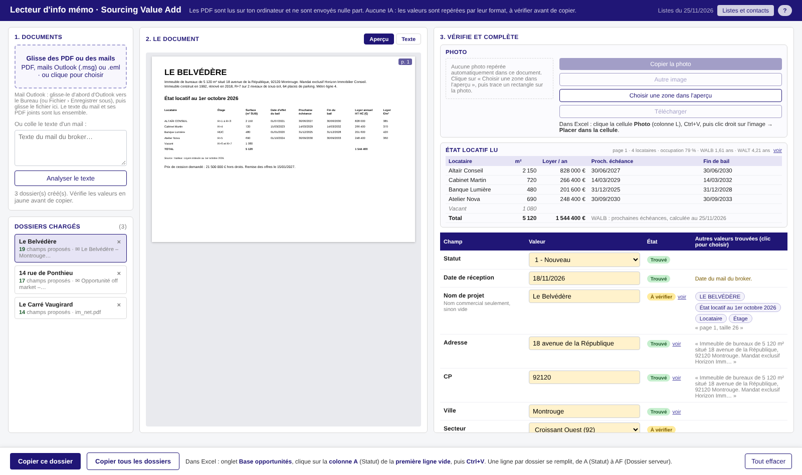

# Lecteur d'info mémo

Un outil qui lit les documents de vente d'immeubles reçus des brokers (teasers, info mémos, one pagers, mails) et prépare une ligne prête à coller dans un tableau de suivi Excel. Adresse, surface, loyer, taux d'occupation, WALB, prix, date limite, broker, contact : les champs se remplissent en quelques secondes, puis on vérifie et on colle.

Tout tient dans **un seul fichier HTML** qui s'ouvre dans Edge ou Chrome. Pas d'installation, pas de serveur, pas de compte, et **aucune IA** : les documents sont lus dans le navigateur, rien n'est envoyé sur internet. L'outil a été conçu pour un poste de travail où les outils d'IA sont bloqués.



*Les documents, brokers, locataires et contacts de ce dépôt sont fictifs.*

## Essayer

Ouvre `index.html` dans ton navigateur (ou la démo en ligne si GitHub Pages est activé sur le dépôt), puis glisse les fichiers du dossier `exemples/` :

- `im_net.pdf` : un teaser simple ;
- `im_rentroll.pdf` : un teaser avec un état locatif (tableau des locataires) ;
- `mails/belvedere_horizon.eml` : un mail de broker avec le teaser en pièce jointe ;
- `mails/marbeuf_transfere.eml` : un mail transféré par un collègue, sans pièce jointe.

## Ce que fait l'outil

- **Lecture des PDF.** Repère une trentaine de champs par leur format et leurs libellés : surfaces (en écartant les tableaux de surfaces par étage), montants en €, k€ et M€ (loyer net, brut ou chiffre d'affaires), adresse et code postal (y compris « Paris 19 » ou « 20ème arrondissement »), régime de détention, situation locative, dates, mode de commercialisation.
- **Decks multi-opportunités.** Un document qui présente une opportunité par page donne un dossier par page.
- **One pagers.** Lecture des chiffres clés en gros caractères (« 895 m² », « 100 % loué », « 480 K€/an ») et classement automatique d'un montant sans libellé en loyer ou en prix, selon le ratio au m².
- **État locatif.** Détection du tableau des locataires, même avec un en-tête sur deux lignes, une ligne vacante et un total. Calcul du loyer total, du taux d'occupation et de la WALB/WALT pondérées par les loyers.
- **Mails.** Lecture des fichiers Outlook `.msg` et `.eml` avec leurs PDF joints. La date du mail devient la date de réception, l'expéditeur donne le broker et le contact (y compris dans un mail transféré), et le prix ou la date limite cités dans le mail passent avant ceux du PDF.
- **Description rédigée.** Un texte de 3 à 6 phrases construit à partir des champs (nature, surface, détention, année, étages, équipements, occupation, locataires, urbanisme, desserte), sans IA, avec des phrases types.
- **Photo.** Repère les photos du document en tenant compte des recadrages, ou laisse choisir une zone dans l'aperçu, puis la copie pour Excel.
- **Vérification.** Chaque valeur porte un état (trouvé, à vérifier, non trouvé), un lien qui surligne l'endroit du PDF où elle a été lue, et les autres valeurs possibles en un clic.
- **Listes à jour sans code.** Les listes déroulantes et les contacts se mettent à jour en collant l'onglet Excel, et l'outil produit lui-même une nouvelle version du fichier à partager.

## Comment c'est construit

| Fichier | Rôle |
|---|---|
| `src/extract.js` | Règles de lecture : reconstitution des lignes et des colonnes à partir du texte brut de pdf.js, extraction champ par champ, état locatif, chiffres clés, découpage des decks, fusion mail + PDF, rédaction de la description. |
| `src/mail.js` | Lecture des mails : MIME pour `.eml` (quoted-printable, base64, jeux de caractères, noms de fichiers encodés), fichiers composés Outlook pour `.msg` (propriétés MAPI, pièces jointes, RTF compressé). |
| `src/template.html` | Interface : aperçu du PDF, tableau des champs, copie au format Excel (tabulations, nombres au format français), photo, mode d'emploi. |
| `listes.exemple.json` | Listes déroulantes et contacts d'exemple. Tes vraies listes vont dans `listes.json`, ignoré par git. |
| `assemble.py` | Assemble le tout en un seul `index.html`. Les bibliothèques sont compressées en gzip puis encodées en base64, et décompressées par le navigateur à l'ouverture (0,8 Mo au lieu de 2,4 Mo). |
| `vendor/` | [pdf.js](https://github.com/mozilla/pdf.js) (Mozilla) et [cfb](https://github.com/SheetJS/js-cfb) (SheetJS), sous licence Apache 2.0. |
| `tests/` | Script de vérification et générateurs des documents d'exemple. |

## Construire et tester

```bash
python3 assemble.py      # produit index.html (Python 3 suffit)
npm install              # une fois, pour les tests
npm test                 # 32 valeurs justes, 0 écart attendu
```

Pour utiliser tes propres listes, crée `listes.json` sur le modèle de `listes.exemple.json` : il est pris à la place de l'exemple lors de la construction et n'est jamais versionné. Dans `src/extract.js`, remplace aussi `monentreprise\.example` par le domaine de messagerie de ton entreprise (constante `INTERNE`).

## Limites

- Les PDF scannés (images sans texte) ne sont pas lus : l'outil le signale.
- Un broker qui n'apparaît que dans un logo n'est pas reconnu.
- Les règles ont été réglées sur six documents réels de brokers (dont un deck de 13 opportunités) : un nouveau format peut demander d'ajuster `src/extract.js`. Les valeurs restent toujours à vérifier avant de les coller.

---

## English summary

A single-file, offline HTML tool that reads real estate sale documents sent by brokers (teasers, information memorandums, one-pagers, Outlook `.msg` and `.eml` emails) and turns them into a tab-separated row ready to paste into an Excel deal-tracking sheet. It extracts around 30 fields (address, area, rent, occupancy, WALB, asking price, deadline, broker, contact), parses rent rolls, splits multi-asset decks into one record per page, writes a short asset description from the extracted fields, and lets you copy the building photo. No AI and no server: everything runs in the browser with pdf.js, which made it usable on a workstation where AI tools are blocked. Sample documents in `exemples/` are fictional.
